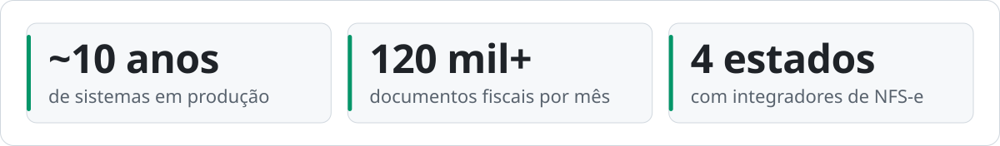
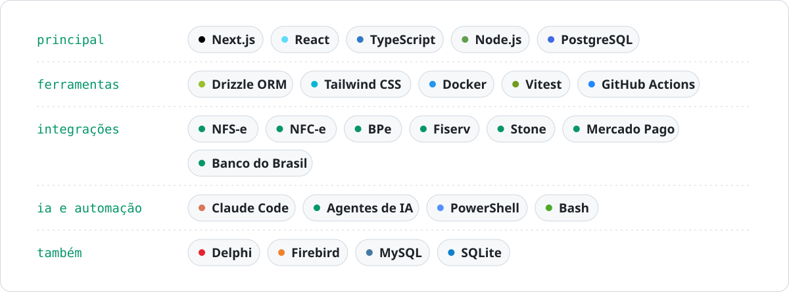
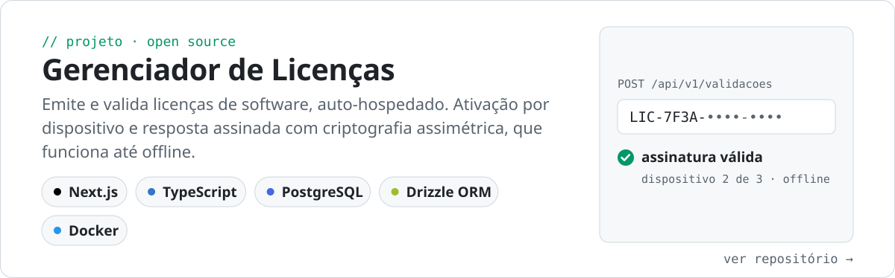
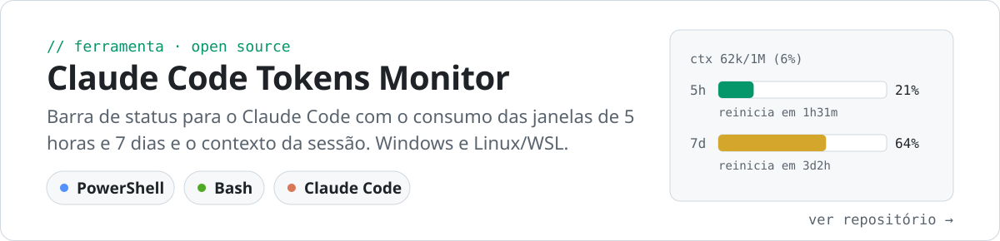
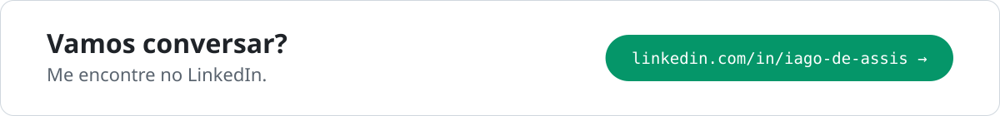

<picture>
  <source media="(prefers-color-scheme: dark)" srcset="./assets/banner-escuro-v2.svg">
  
</picture>

### Sobre mim

Sou Analista de Sistemas e há quase 10 anos construo software que roda em produção todos os dias. Na empresa onde trabalho sou o único da área, então cuido do ciclo inteiro: converso com o cliente, analiso, desenvolvo, pesquiso novas soluções e dou suporte. Isso me ensinou a enxergar o sistema pelo lado de quem usa.

Desenvolvi integradores de documentos fiscais eletrônicos (NFS-e, NFC-e e BPe) que hoje processam mais de 120 mil documentos por mês em municípios do Pará, Amazonas, Rondônia e Minas Gerais, além de integrações de pagamento com Fiserv, Stone, Mercado Pago e Banco do Brasil.

Comecei e cresci com Delphi. Hoje meu foco é web, com Next.js, React, Node.js, TypeScript e PostgreSQL, e desenvolvo com agentes de IA no dia a dia, sempre com decisões documentadas, testes e CI.

<picture>
  <source media="(prefers-color-scheme: dark)" srcset="./assets/numeros-escuro.svg">
  
</picture>

### Stack

<picture>
  <source media="(prefers-color-scheme: dark)" srcset="./assets/stack-escuro.svg">
  
</picture>

### Projetos em destaque

<a href="https://github.com/IagoACAssis/gerenciador-licencas">
  <picture>
    <source media="(prefers-color-scheme: dark)" srcset="./assets/projeto-licencas-escuro.svg">
    
  </picture>
</a>

<a href="https://github.com/IagoACAssis/TokensMonitor">
  <picture>
    <source media="(prefers-color-scheme: dark)" srcset="./assets/projeto-tokens-escuro.svg">
    
  </picture>
</a>

 

<a href="https://www.linkedin.com/in/iago-de-assis">
  <picture>
    <source media="(prefers-color-scheme: dark)" srcset="./assets/contato-escuro.svg">
    
  </picture>
</a>
